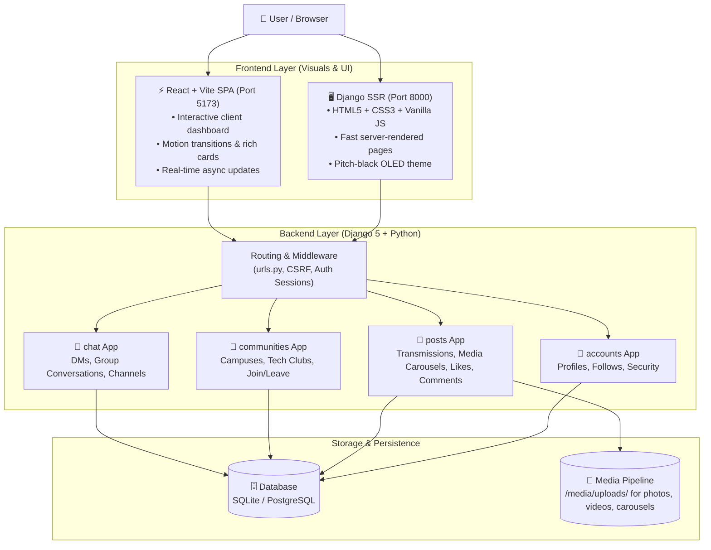

# 🛡️ Sanctuary Network — System Architecture & Usage Guide

> **"A more organic, personal, and secure alternative to modern social media."**  
> Built for genuine connection with people you actually know — free from corporate algorithms, intrusive ads, and public surveillance.

---

## 🌟 1. The Core Vision & Purpose

### Why Was This Project Created?
Modern social media platforms (Instagram, X, TikTok) are engineered for **maximum screen addiction**, **ad impressions**, and **public viral reach**. This leads to:
- Algorithms deciding what you see instead of your actual friends.
- Anxiety-inducing follower metrics and public clout-chasing.
- Data harvesting, tracking cookies, and invasive targeting.
- Exposure of personal moments to random strangers on the internet.

### The Sanctuary Philosophy:
Sanctuary Network was created from the ground up to restore **authenticity, intimacy, and privacy**:
1. **Organic & Chronological**: You see posts in the order they were sent by people and communities you actually care about. No black-box algorithmic feeds.
2. **Personal Circles**: Designed for college campuses (e.g., CMRIT), close friend groups, project teams, and mutuals.
3. **Private & Secure by Default**: 
   - Direct 1-on-1 private messaging (DMs) between mutuals.
   - Custom closed Group Chats created on the fly.
   - Dedicated Communities with member-only channels and verified announcements.
4. **Distraction-Free Cyberpunk/OLED Aesthetic**: A high-contrast, dark-mode design that is easy on the eyes, saves battery on OLED screens, and treats social software like a powerful private terminal rather than a casino slot machine.

---

## 🏗️ 2. High-Level Architecture (The Big Picture)



---

## ⚙️ 3. How the Backend Works (Python & Django)

The backend acts as the secure brain of the network. It handles business logic, database queries, file storage, and access permissions.

### 🧩 The Four Modular Apps

| App Name | File Location | What It Does |
|---|---|---|
| **`accounts`** | `accounts/` | **Identity & Social Graph**: Handles user registration, PBKDF2 encrypted password login/logout, profile avatars, bios, and follower/following relationships. |
| **`posts`** | `posts/` | **Content & Transmissions**: Stores user posts ("transmissions"), multi-image carousel items (`PostMedia`), automated thumbnail generation, like toggles, and nested comments. |
| **`communities`** | `communities/` | **Micro-Networks & Spaces**: Dedicated spaces (e.g. CMRIT Campus, Dev Circles, Design Labs) with membership management, role permissions (Admin vs Member), and rule sets. |
| **`chat`** | `chat/` | **Encrypted Private Messaging**: 1-on-1 direct messages (DMs), custom multi-user group conversations, and community discussion channels. |

---

### 🔒 Built-in Privacy & Security Features

1. **Password Protection**: Passwords are never stored in plain text. Django uses **PBKDF2 with SHA-256** cryptographic hashing.
2. **CSRF Immunity**: Every POST form submission requires a cryptographically signed `` to prevent cross-site request attacks.
3. **Safe Media Access**: Image file paths and carousels use safe properties (`primary_media_url`, `primary_thumbnail_url`) so missing files or corrupt uploads never crash the system.
4. **Scoped Group Chats**: Group conversations are isolated; only verified participants can read or append messages to the conversation thread.

---

## 🎨 4. How the Frontend Works

Sanctuary provides a **Dual Frontend Experience** tailored for performance, minimalism, and elegance.

### 🖤 The OLED / Cyberpunk Visual Design
- **Pitch Black Background (`#000000`)**: True black that saves battery on modern mobile/laptop OLED displays.
- **Neon Accents (`#c4f36b` Neon Lime & `#00e5ff` Cyan)**: Gives the feeling of an authentic personal terminal rather than a generic corporate website.
- **Monospace Typography**: Clean metadata tags (`TRANSMISSION`, `ENCRYPTED`, `COMMUNITY_ID`) for clarity and style.

### 🌐 Dual Presentation Engines

#### 1. Django SSR (Port 8000) — *The Instant, Dependable Interface*
- **How it works**: The server generates the complete HTML page and delivers it immediately.
- **Benefits**: Zero load spinner, works on low-power devices, perfect search indexing, instantaneous navigation.
- **Key Templates**:
  - `templates/posts/feed.html`: Chronological home feed of close friends.
  - `templates/accounts/profile.html`: User bio, avatar, transmission grid, follow/unfollow and DM button.
  - `templates/communities/detail.html`: Community hero, member roster, announcement banner, and channels.
  - `templates/chat/conversation_detail.html`: Clean, encrypted chat screen for DMs and groups.

#### 2. React + Vite SPA (Port 5173) — *The Dynamic Interactive Interface*
- **How it works**: A high-performance single page application built with React, Lucide icons, and Tailwind/CSS tokens that talks to Django's JSON endpoints.
- **Benefits**: Instant client-side transitions, micro-interactions, drag-and-drop carousels, and smooth tab switching.

---

## 📱 5. Basic Use Cases: A Walkthrough

### 1. Connecting with Friends
1. Search or visit a mutual's profile (e.g., `http://127.0.0.1:8000/accounts/profile/alex_dev/`).
2. Click **Follow User** to establish a personal link.
3. Their transmissions will now appear directly in your chronological feed.

### 2. Sharing a Transmission (Post)
1. Click **+ New Transmission** from the navigation bar.
2. Write your caption and upload one or multiple pictures (carousels are automatically supported).
3. The post is timestamped and broadcasted only to your network without algorithmic suppression.

### 3. Starting a Private Group Chat
1. Go to **Messages** or visit `http://127.0.0.1:8000/chat/new-group/`.
2. Give your group a title (e.g., `Weekend Hackathon Team`, `Study Circle`).
3. Select your friends from the list and hit **Create Group**.
4. Chat privately in a dedicated, isolated thread.

### 4. Engaging in Communities (e.g., CMRIT)
1. Head to **Communities** (`http://127.0.0.1:8000/communities/`).
2. Join a verified community (like CMRIT Campus Community).
3. Access college notices, hackathon updates, peer projects, and specialized discussion channels.

---

## 🚀 6. Quickstart: How to Run the Project

### Prerequisites
- Python 3.10+ (with virtual environment in `.\venv\`)
- Node.js 18+ (for frontend)

### Step 1: Start the Backend (Django / Waitress)
Open your terminal in the project directory:
```powershell
# Activate virtual environment
.\venv\Scripts\activate

# Start the production-grade Waitress server (Port 8000)
python serve_backend.py
```
> The backend and SSR interface is now live at **`http://127.0.0.1:8000`**.

### Step 2: Start the React Frontend (Optional / Concurrent)
In a second terminal window:
```powershell
cd frontend
npm run dev
```
> The React interactive SPA is now live at **`http://localhost:5173`**.

---

## 🧭 7. Essential URL Directory

| Destination | URL Path | What to Expect |
|---|---|---|
| **Home Feed** | `/` | Chronological posts from followed friends |
| **Explore** | `/explore/` | Grid overview of community transmissions |
| **Communities** | `/communities/` | List of local clubs, campus spaces & groups |
| **New Post** | `/posts/create/` | Upload photos, carousels, and captions |
| **Inbox & DMs** | `/chat/inbox/` | All your 1-on-1 and group conversations |
| **New Group Chat** | `/chat/new-group/` | Create a private multi-user chat room |
| **User Profile** | `/accounts/profile/<username>/` | Identity, stats, and transmission grid |
| **Admin Panel** | `/admin/` | Direct database inspector & management |

---

## 💡 Summary

Sanctuary Network rejects the "attention economy" model of modern social giants in favor of **true utility, digital privacy, and genuine human connection**. Whether you are coordinating a project with classmates or sharing memories with close friends, your data stays in your hands.
